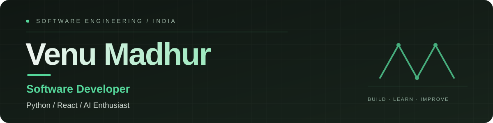

 

&nbsp;

&nbsp;

 

`HYDERABAD, INDIA` &nbsp; · &nbsp; `B.TECH COMPUTER SCIENCE · 2026`

---

## ABOUT

Software developer interested in building useful applications with thoughtful engineering. Work and learning span Python backend development, React interfaces, relational databases, problem-solving, and applied AI.

I enjoy understanding a product end to end — from defining the problem and shaping the architecture to implementing workflows, handling data, and documenting decisions that keep software maintainable.

## TECHNOLOGIES

**LANGUAGES**

**FRONTEND**

**BACKEND & DATA**

**TOOLS**

AI / ML project experience: PyTorch · Flower · Opacus. These are listed as project technologies, not proficiency claims.

---

## SELECTED WORK

  ENGINEERING PROJECTS / SELECTED REPOSITORIES

<table>
<tr>
<td width="50%" valign="top">

### 01 — CineVerse

**Full-stack subscription and billing workflows**

A platform covering subscription plans, payment states, invoices, refunds, reporting, and administrative operations.

`React` `FastAPI` `PostgreSQL` `Redis` `Celery`

[**EXPLORE REPOSITORY ↗**](https://github.com/VenuMadhur/CineVerse)

</td>
<td width="50%" valign="top">

### 02 — AI Programming Mentor

**A structured programming-learning platform**

Organized around learner profiles, skill assessment, personalized mentoring, coding challenges, evaluation, and progress.

`Python` `Flask` `React` `SQLAlchemy`

Public documentation distinguishes implemented foundations from planned modules. AI integration and remaining workflows should be verified before describing this as complete.

[**EXPLORE REPOSITORY ↗**](https://github.com/VenuMadhur/ai-programming-mentor)

</td>
</tr>
<tr>
<td width="50%" valign="top">

### 03 — VIA

**Personal and family health organization**

A React application concept for organizing medicines, appointments, medical documents, bills, reminders, and health records.

`React` `JavaScript`

[**EXPLORE REPOSITORY ↗**](https://github.com/VenuMadhur/VIA)

</td>
<td width="50%" valign="top">

### 04 — Voicebot

**Voice and text assistant**

Explores browser speech capabilities and Gemini-powered conversational workflows through a web interface.

`React` `JavaScript` `Gemini API`

[**EXPLORE REPOSITORY ↗**](https://github.com/VenuMadhur/Voicebot)

</td>
</tr>
</table>

### More repositories

| Project | Focus |
|:--|:--|
| [Weather Status Viewer](https://github.com/VenuMadhur/weather-status-viewer) | React interface and API integration |
| [Mini-Projects](https://github.com/VenuMadhur/Mini-Projects) | Frontend exercises and small applications |

Project summaries should always match the current implementation. Add genuine screenshots, architecture diagrams, tests, and deployed previews to each repository as they become available.

---

## CURRENT FOCUS

| 01 / PROBLEM SOLVING | 02 / APPLICATION ENGINEERING | 03 / APPLIED AI |
|:---:|:---:|:---:|
| Data structures, algorithms, and writing clear solutions | Python APIs, React applications, data modeling, and testing | Exploring practical machine learning and AI-powered workflows |

## GITHUB ACTIVITY

[View contribution history](https://github.com/VenuMadhur?tab=overview) &nbsp; · &nbsp; [Explore repositories](https://github.com/VenuMadhur?tab=repositories)

<!-- Enable the contribution snake after the workflow has completed successfully.
     The workflow publishes the SVG to the output branch. -->
<!--

  

-->

---

### LET'S BUILD SOMETHING USEFUL.

Open to connecting about software engineering, full-stack development, and applied AI.

<a href="https://www.linkedin.com/in/cholletivenumadhur/">LINKEDIN</a>
&nbsp; / &nbsp;
<a href="mailto:cholletivenumadhur@gmail.com">EMAIL</a>
&nbsp; / &nbsp;
<a href="https://github.com/VenuMadhur">GITHUB</a>

  

BUILD WITH INTENT. LEARN BY SHIPPING. IMPROVE WITH EVIDENCE.

