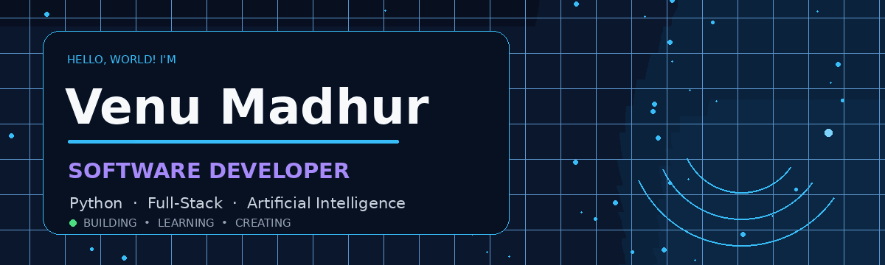
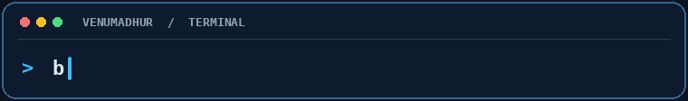

 

 

Hyderabad, India · B.Tech CSE, 2026

---

## ABOUT

I'm a Software Developer who enjoys turning ideas into practical applications through thoughtful engineering. My interests span Python development, full-stack engineering, databases, problem-solving, and Artificial Intelligence.

I enjoy understanding problems from the ground up — designing solutions, building reliable workflows, working with data, and continuously improving the way software is developed.

Currently focused on strengthening my engineering skills and building projects that solve meaningful problems.
---
## TECHNICAL EXPERTISE

<table>
  <tr>
    <td width="50%" valign="top">

**01 / PROGRAMMING LANGUAGES**

  

</td>
    <td width="50%" valign="top">

**02 / FRONTEND DEVELOPMENT**

   

</td>
  </tr>
  <tr>
    <td width="50%" valign="top">

**03 / BACKEND DEVELOPMENT**

  

 </td>
    <td width="50%" valign="top">

**04 / DATABASES**

 

 </td>
  </tr>
  <tr>
    <td width="50%" valign="top">

**05 / AI & MACHINE LEARNING**

  

 </td>
    <td width="50%" valign="top">

**06 / DEVELOPER TOOLS**

   

</td>
  </tr>
</table>

---
---

## SELECTED WORK

<table>
<tr>
<td width="50%" valign="top">

### 01 — CineVerse

**Full-stack subscription and billing workflows**

A platform covering subscription plans, payment states, invoices, refunds, reporting, and administrative operations.

`React` `FastAPI` `PostgreSQL` `Redis` `Celery`

[**VIEW REPOSITORY ↗**](https://github.com/VenuMadhur/CineVerse)

</td>
<td width="50%" valign="top">

### 02 — AI Programming Mentor

**A structured programming-learning platform**

Organized around learner profiles, skill assessment, personalized mentoring, coding challenges, evaluation, and progress.

`Python` `Flask` `React` `SQLAlchemy`

Public documentation distinguishes implemented foundations from planned modules. AI integration and remaining workflows need verification.

[**VIEW REPOSITORY ↗**](https://github.com/VenuMadhur/ai-programming-mentor)

</td>
</tr>
<tr>
<td width="50%" valign="top">

### 03 — VIA

**Personal and family health organization**

A React application concept for organizing medicines, appointments, medical documents, bills, reminders, and health records.

`React` `JavaScript`

[**VIEW REPOSITORY ↗**](https://github.com/VenuMadhur/VIA)

</td>
<td width="50%" valign="top">

### 04 — Voicebot

**Voice and text assistant**

Explores browser speech capabilities and Gemini-powered conversational workflows through a web interface.

`React` `JavaScript` `Gemini API`

[**VIEW REPOSITORY ↗**](https://github.com/VenuMadhur/Voicebot)

</td>
</tr>
</table>

### MORE WORK

- [Weather Status Viewer](https://github.com/VenuMadhur/weather-status-viewer) — React interface and API integration.
- [Mini-Projects](https://github.com/VenuMadhur/Mini-Projects) — frontend exercises and small applications.

---

## CURRENT ENGINEERING FOCUS

<table>
<tr>
<td width="33%" valign="top">

**01 / PROBLEM SOLVING**

Data structures, algorithms, and writing clear solutions.

</td>
<td width="33%" valign="top">

**02 / APPLICATION ENGINEERING**

Python APIs, React applications, data modeling, and testing.

</td>
<td width="33%" valign="top">

**03 / APPLIED AI**

Exploring practical machine learning and AI-powered workflows.

</td>
</tr>
</table>

## GITHUB ACTIVITY

[Contribution history](https://github.com/VenuMadhur?tab=overview) &nbsp; · &nbsp; [All repositories](https://github.com/VenuMadhur?tab=repositories)

<!-- Uncomment after the contribution workflow succeeds and publishes to output.

  

-->

---

### LET'S BUILD SOMETHING USEFUL.

Open to connecting about software engineering, full-stack development, and applied AI.

[LINKEDIN](https://www.linkedin.com/in/cholletivenumadhur/) &nbsp; / &nbsp;
[EMAIL](mailto:cholletivenumadhur@gmail.com) &nbsp; / &nbsp;
[GITHUB](https://github.com/VenuMadhur)

 

BUILD WITH INTENT. LEARN BY SHIPPING. IMPROVE WITH EVIDENCE.

